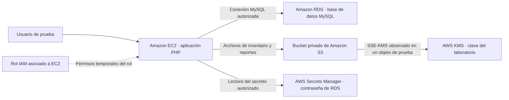

# Arquitectura del laboratorio

[Volver al índice](../README.md)

Este diagrama describe el despliegue académico reportado en noviembre de 2026. No representa una configuración publicada ni una aplicación disponible para uso externo.

- **EC2** aloja la aplicación PHP. El SDK usa el rol de la instancia, sin que una clave de acceso permanente de AWS tenga que quedar en el repositorio.
- **RDS** mantiene los datos y sesiones de la aplicación. El grupo de seguridad de la base admite MySQL desde el grupo de seguridad de EC2.
- **S3** separa de la instancia los archivos de productos y los reportes. El laboratorio usó un bucket privado con permisos por operación y prefijo.
- **Secrets Manager** suministra la contraseña de RDS a la aplicación. El rol autoriza la lectura del secreto específico del laboratorio.
- **KMS** se utilizó en S3 en el laboratorio revisado; se confirmó el modo de cifrado de un objeto de prueba. El repositorio público tiene una diferencia importante: [la carga de productos](https://github.com/LuisS-byte/inventario-camisas/blob/main/config/s3.php#L120) y [la carga de reportes](https://github.com/LuisS-byte/inventario-camisas/blob/main/scripts/generar_reporte.php#L186) aún especifican `AES256`. El cifrado de una prueba en el laboratorio no demuestra que esas dos rutas del código público usen SSE-KMS.
